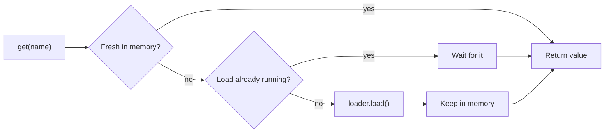
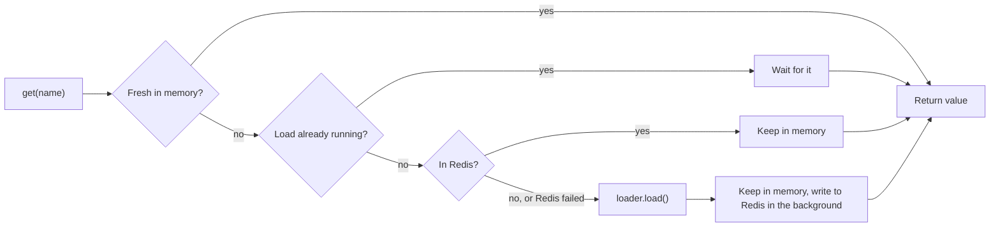

# reference-data-cache

[](https://github.com/jtkunley/reference-data-cache/actions/workflows/ci.yml)
[](package.json)
[](package.json)
[](src/index.ts)
[](package.json)
[](LICENSE)

Named, read-through caching for **reference data** in Node.js: country lists, product
catalogs, feature tables, anything small, read often, and loaded as a whole.

It comes in two shapes, one per use case:

|                        | **Reader**            | **Owner** (read-write)                            |
| ---------------------- | --------------------- | ------------------------------------------------- |
| Create with            | `createCacheReader()` | `createCacheOwner()`                              |
| Where values live      | This process's memory | This process's memory, plus a shared tier (Redis) |
| On a miss              | Calls your loader     | Tries the shared tier, then calls your loader     |
| Writes the shared tier | Never                 | After each load, in the background                |
| Can invalidate         | No                    | Yes, locally and in the shared tier               |
| Needs Redis            | No                    | Yes, or any custom `CacheTier`                    |

Both load **single-flight**: concurrent misses for a domain share one load per client.
Neither has runtime dependencies or requires a particular Redis client.

## Install

```sh
npm install @jtkunley/reference-data-cache
```

Requires Node.js 22 or later. Ships ESM, CommonJS, and type declarations.

## Use case 1: Reader, a local cache in front of a loader

Use a reader when a process just needs to avoid reloading reference data on every request,
and doesn't need to share loaded values with other processes.

```ts
import { createCacheReader } from '@jtkunley/reference-data-cache';

const cache = createCacheReader({ inMemoryPolicy: { ttlMs: 60_000 } });

cache.register({
  name: 'countries',
  loader: { load: () => db.query('SELECT code, name FROM countries') },
});

const countries = await cache.get<Country[]>('countries');
```

How a reader serves `get`:



- Values expire `ttlMs` after they were loaded (default 5 minutes); reads don't extend them.
- A failed load rejects every waiting caller and isn't cached, so the next read tries again.
- There's no background refresh: an expired value is reloaded by the next read.

## Use case 2: Owner, sharing loaded values through Redis

Use an owner when several processes read the same reference data and you want one load to
serve all of them, or when you change the data and need to invalidate the cached copy.

An owner reads from and writes to a **shared tier**. `RedisCacheTier` takes any client that
fits a three-method interface; here it wraps [`redis`](https://www.npmjs.com/package/redis)
v4 or later:

```ts
import { createClient } from 'redis';
import { RedisCacheTier, createCacheOwner } from '@jtkunley/reference-data-cache';

const redis = createClient();
await redis.connect();

const sharedTier = new RedisCacheTier({
  get: (key) => redis.get(key),
  set: async (key, value, ttlMs) => {
    await redis.set(key, value, { PX: ttlMs });
  },
  delete: async (key) => {
    await redis.del(key);
  },
});

const cache = createCacheOwner({
  sharedTier,
  inMemoryPolicy: { ttlMs: 60_000 },
  onTierError: ({ domain, operation, kind, error }) => {
    logger.warn({ domain, operation, kind, err: error }, 'shared cache failure');
  },
});

cache.register({
  name: 'countries',
  loader: { load: loadCountries },
  sharedPolicy: { ttlMs: 3_600_000 },
});

const countries = await cache.get<Country[]>('countries');

// After you change the source data:
await cache.invalidate('countries');
```

How an owner serves `get`:



- **Redis problems never fail a read.** Timeouts, outages, and corrupt entries are passed to
  `onTierError`, and the loader is used instead. A corrupt entry is also deleted.
- **Writes are not awaited.** `get` returns as soon as the value is loaded; a successful read
  doesn't mean the value reached Redis.
- **TTLs must nest.** The in-memory TTL can't exceed the shared TTL. The shared TTL comes
  from `sharedPolicy`, or the tier's default (12 hours) at registration time.
- **Invalidation is local plus shared.** `invalidate` clears this process's copy immediately,
  deletes the Redis entry, and resolves once that delete succeeds. Other processes keep
  their in-memory copies until they expire.
- **One tier instance per owner.** Several `RedisCacheTier` instances can share one Redis
  connection.

### Using `redis` v3 (callback API)

```ts
import redis from 'redis';
import { createRedisCacheTierFromRedisV3 } from '@jtkunley/reference-data-cache';

const sharedTier = createRedisCacheTierFromRedisV3(redis.createClient(), {
  operationTimeoutMs: 250,
});
```

The adapter calls `get(key, cb)`, `set(key, payload, 'PX', ttlMs, cb)`, and `del(key, cb)`.
In both setups, creating, reconnecting, and closing the Redis connection stay with you.

## Concepts

**Domain.** One named cached value with a loader. Names are exact and case-sensitive.
Loaders take no arguments and must not resolve to `null` or `undefined`; falsy values like
`0`, `false`, `''`, `[]`, and `{}` are fine.

**Policies.** `{ ttlMs }`, measured from the latest write. Set a client-wide in-memory default
with `inMemoryPolicy` and override it per domain. Policies are copied and frozen on
registration, so mutating your objects later has no effect.

**References and JSON.** In-memory values are kept by reference, not cloned or frozen.
Values that pass through Redis go through JSON, so use JSON-compatible data if results must
match across tiers.

## API

### Reader

| Member                        | Description                                                                 |
| ----------------------------- | --------------------------------------------------------------------------- |
| `createCacheReader(options?)` | Creates a `CacheReader`. `options.inMemoryPolicy` sets the default TTL.     |
| `register(domain)`            | Registers `{ name, loader, inMemoryPolicy? }` without loading. Synchronous. |
| `get<T>(name)`                | Resolves the value, loading it on a miss. `T` is an unchecked assertion.    |

### Owner

Everything a reader has, plus:

| Member                      | Description                                                                                                              |
| --------------------------- | ------------------------------------------------------------------------------------------------------------------------ |
| `createCacheOwner(options)` | Creates a `CacheOwner`. Requires `sharedTier`; accepts `inMemoryPolicy` and `onTierError`.                               |
| `register(domain)`          | Also accepts `sharedPolicy`, and registers the domain with the shared tier.                                              |
| `invalidate(name)`          | Clears the local copy and deletes the shared one. Rejects if the delete fails, but the local copy is cleared either way. |

`onTierError` receives `{ domain, tier: 'shared', operation, kind, error }` once per failed
shared operation. `operation` is `get`, `set`, or `delete`; `kind` is `timeout`,
`serialize`, `corrupt-value`, or `error`; `error` is the original failure. The hook's
return value is ignored, and anything it throws or rejects is contained.

### Shared tiers

| Class               | `NAME`        | Default TTL | TTL rule              |
| ------------------- | ------------- | ----------- | --------------------- |
| `RedisCacheTier`    | `'redis'`     | 12 hours    | positive safe integer |
| `InMemoryCacheTier` | `'in-memory'` | 5 minutes   | finite, `>= 0`        |

Both implement `CacheTier` (`defaultPolicy`, `setDefaultPolicy`, `register`, `unregister`,
`get`, `set`, `delete`), which you can also implement yourself. `get` resolves
`{ hit: false }` or `{ hit: true, value }`. `InMemoryCacheTier` is mainly useful in tests or
as a stand-in for Redis.

`RedisCacheTier` stores JSON under `reference-data-cache:v1:<name>` and gives each Redis call
its own deadline, `operationTimeoutMs` (default `DEFAULT_REDIS_OPERATION_TIMEOUT_MS`,
500 ms). Its `unregister` leaves the stored key in place.

### Errors

| Error                               | When                                         |
| ----------------------------------- | -------------------------------------------- |
| `CacheDomainAlreadyRegisteredError` | Registering a name twice on a client or tier |
| `CacheDomainNotRegisteredError`     | Using a name that was never registered       |
| `CacheTierTimeoutError`             | A Redis call exceeded `operationTimeoutMs`   |
| `CacheTierSerializationError`       | A value could not be converted to JSON       |
| `CacheTierCorruptValueError`        | A stored Redis value was not valid JSON      |

All expose `domainName`; the timeout error also exposes `operation` and `timeoutMs`.
Invalid policies and options throw `TypeError` or `RangeError`, and a failed registration
leaves nothing registered.

## Guarantees and limits

The library deliberately does **not** provide:

- **Cross-process coordination.** Single-flight loading is per client instance. Other
  processes may load the same domain at the same time.
- **Invalidation broadcast.** Other processes keep their in-memory copies until they expire.
- **A freshness barrier.** Reads that overlap an invalidation may see older values, and a
  Redis write dispatched before invalidation may still land afterwards. If the delete fails,
  later reads may bring the old value back from Redis.
- **Write confirmation or draining.** Redis writes are best effort, and nothing waits for
  them on shutdown.
- **Cancellation.** A Redis timeout stops waiting but doesn't cancel the request. Loaders
  and custom tiers have no timeout; if they hang, callers wait.
- **Scheduled refresh or eviction.** No background refresh, stale-while-revalidate, or
  capacity limit.
- **Schema validation.** Values are not checked at runtime.

The full behavioral contract is in [`docs/behavior-spec.md`](docs/behavior-spec.md).

## Development

```sh
npm install
npm run check   # typecheck, lint, format check, tests
npm run build   # dist/ (ESM + CJS + type declarations)
```

See [CONTRIBUTING.md](CONTRIBUTING.md) for the project layout.

## License

[MIT](LICENSE)
