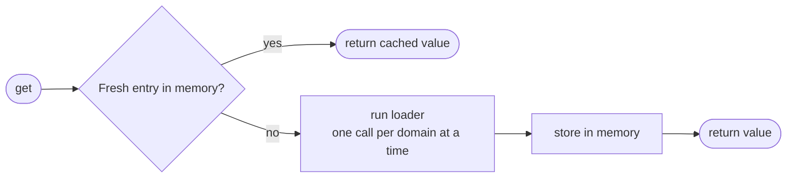
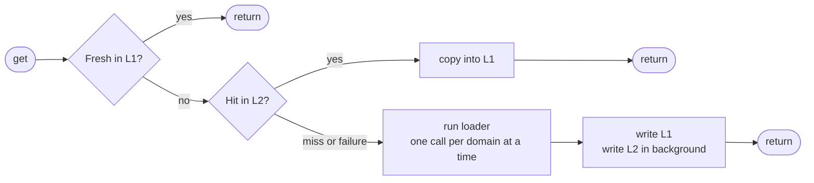

# reference-data-cache

[](https://github.com/jtkunley/reference-data-cache/actions/workflows/ci.yml)
[](LICENSE)

A small, strongly typed read-through cache for **reference data** in Node.js services: the slowly changing datasets, such as countries, currencies, product catalogues, or configuration, that many requests read and few write. Register each dataset once as a named **domain** with a loader, and the library takes care of lookups, expiry, concurrent-miss deduplication, and (optionally) a shared Redis layer that degrades gracefully when Redis misbehaves.

It is deliberately not a general key-value cache. Each domain holds a single value, the whole dataset, which is loaded, expired, and invalidated as a unit; there are no per-key entries, size limits, or eviction.

## Features

- **Read-through by design**: callers ask for a domain by name; on a miss the library runs that domain's loader and caches the result.
- **Two client flavours**: an in-process cache for data you consume, and a two-level cache (memory + shared store) for data your service owns.
- **Single-flight loading**: concurrent misses for the same domain trigger exactly one loader call.
- **Fault-tolerant shared tier**: Redis outages, slow replies, corrupt payloads, and serialization failures fall back to the loader instead of failing requests.
- **Bounded Redis calls**: every operation has a timeout, so a disconnected client that queues commands cannot stall your service.
- **Observability hook**: every shared-tier failure is reported through a single `onTierError` callback.
- **Zero runtime dependencies**: Redis is accessed through a minimal interface, so you bring your own client.

## Contents

- [Quick start](#quick-start)
- [Core concepts](#core-concepts)
- [Choosing a client](#choosing-a-client)
- [CacheReader](#cachereader)
- [CacheOwner](#cacheowner)
- [Storage tiers](#storage-tiers)
- [Resilience](#resilience)
- [Patterns](#patterns)
- [API reference](#api-reference)
- [Design notes](#design-notes)
- [Project layout](#project-layout)
- [Development](#development)

## Quick start

```ts
import { createCacheReader } from '@jtkunley/reference-data-cache';

interface Country {
    code: string;
    name: string;
}

const cache = createCacheReader({ inMemoryPolicy: { ttlMs: 10 * 60_000 } });

cache.register<Country[]>({
    name: 'countries',
    loader: {
        load: async () => {
            const response = await fetch('https://api.example.com/countries');
            return (await response.json()) as Country[];
        },
    },
});

// First call runs the loader; calls within the next 10 minutes are served from memory.
const countries = await cache.get<Country[]>('countries');
```

## Core concepts

| Concept       | Shape                                                  | Purpose                                                                         |
| ------------- | ------------------------------------------------------ | ------------------------------------------------------------------------------- |
| `CachePolicy` | `{ ttlMs }`                                            | How long an entry remains valid after it is written.                            |
| `CacheLoader` | `{ load(): Promise<T> }`                               | Produces fresh data from the source of truth when the cache has nothing usable. |
| `CacheDomain` | `{ name, loader, inMemoryPolicy?, sharedPolicy? }`     | A named unit of cached data, with optional TTL overrides per tier.              |
| `CacheTier`   | `register`, `get`, `set`, `delete`, plus a default TTL | A storage backend. Clients compose one or two of these.                         |

A few rules apply to every client:

- Domain names are unique per client. Registering a name twice throws `CacheDomainAlreadyRegisteredError`; calling `get` or `invalidate` for a name that was never registered throws `CacheDomainNotRegisteredError`.
- A loader must resolve to a real value or throw. Resolving to `null` or `undefined` is treated as an error, which keeps "nothing cached" and "cached nothing" from being confused.
- A domain without its own policy uses the tier's default TTL.
- TTLs are validated when a domain is registered or a default is set: `ttlMs` must be a finite number of zero or more (Redis requires a positive integer). Anything else throws a `RangeError`, and a failed `register` leaves nothing behind, so it can simply be retried.

## Choosing a client

|                       | `CacheReader`                        | `CacheOwner`                                     |
| --------------------- | ------------------------------------ | ------------------------------------------------ |
| Storage               | Process memory                       | Process memory (L1) backed by a shared tier (L2) |
| Typical data source   | Another service's API                | Your own database                                |
| Shared across nodes   | No; each process loads independently | Yes; one node's load warms the others            |
| Explicit invalidation | No; entries expire by TTL            | Yes, via `invalidate(name)`                      |

Use **CacheReader** when your service consumes reference data it does not own. Use **CacheOwner** in the service that owns the data, so it can share loaded values across instances and invalidate them when the data changes.

## CacheReader

```ts
function createCacheReader(options?: {
    inMemoryPolicy?: CachePolicy;
}): CacheReader;

interface CacheReader {
    register<T>(domain: CacheDomain<T>): void;
    get<T>(domainName: string): Promise<T>;
}
```

`inMemoryPolicy` sets the default TTL for every domain on this reader (5 minutes if omitted); a domain's own `inMemoryPolicy` takes precedence.



If the loader rejects, every caller waiting on that load receives the error, nothing is cached, and the next `get` starts a new load.

## CacheOwner

```ts
function createCacheOwner(options: {
    sharedTier: CacheTier;
    inMemoryPolicy?: CachePolicy;
    onTierError?: (event: CacheTierErrorEvent) => void;
}): CacheOwner;

interface CacheOwner {
    register<T>(domain: CacheDomain<T>): void;
    get<T>(domainName: string): Promise<T>;
    invalidate(domainName: string): Promise<void>;
}
```



Example with Redis:

```ts
import {
    createCacheOwner,
    createRedisCacheTierFromRedisV3,
    type CacheDomain,
} from '@jtkunley/reference-data-cache';
import redis from 'redis';

interface Product {
    sku: string;
    price: number;
}

const owner = createCacheOwner({
    sharedTier: createRedisCacheTierFromRedisV3(redis.createClient(), {
        defaultPolicy: { ttlMs: 60 * 60_000 }, // L2: 1 hour
    }),
    inMemoryPolicy: { ttlMs: 2 * 60_000 }, // L1: 2 minutes
});

const products: CacheDomain<Product[]> = {
    name: 'products',
    loader: { load: () => productRepository.findAll() },
};

owner.register(products);

const catalogue = await owner.get<Product[]>('products');

// After writing to the products table:
await owner.invalidate('products');
```

**TTL constraint.** `register` rejects a domain whose L1 TTL is longer than its L2 TTL, since L1 would otherwise keep serving values L2 has already expired. Both sides fall back to their tier defaults, so if the shared tier is an `InMemoryCacheTier` (default 5 minutes), an L1 TTL above 5 minutes requires an explicit `sharedPolicy`.

**Invalidation.** `invalidate` removes the domain from L1 and L2, so the next `get` runs the loader. Work already in progress cannot undo it: a load or L2 read that started before `invalidate` still answers the callers waiting on it, but its result is not written back to either tier, and new callers start a fresh load instead of joining the old one. See [Resilience](#resilience) for what happens if the L2 delete fails.

## Storage tiers

| Tier                | Default TTL | Characteristics                                                                                                                                                                                  |
| ------------------- | ----------- | ------------------------------------------------------------------------------------------------------------------------------------------------------------------------------------------------ |
| `InMemoryCacheTier` | 5 minutes   | Holds one entry per domain in a `Map`; no size limit. Suited to a modest, fixed set of domains.                                                                                                  |
| `RedisCacheTier`    | 12 hours    | Stores JSON under `reference-data-cache:v1:<domain>`. Each call times out after `operationTimeoutMs` (500 ms by default). TTLs must be positive integers, since they become a Redis `PX` expiry. |

`InMemoryCacheTier` can also act as the shared tier of a `CacheOwner`, which is handy in tests and local development.

### Connecting Redis

`RedisCacheTier` talks to Redis through a three-method interface, exported as `SharedCacheClient`, rather than a specific client library:

```ts
interface SharedCacheClient {
    get(key: string): Promise<string | null>;
    set(key: string, value: string, ttlMs: number): Promise<void>;
    delete(key: string): Promise<void>;
}
```

For the callback-based `redis` v3 package, use `createRedisCacheTierFromRedisV3(client, options)`. For promise-based clients, pass an adapter to the constructor directly. For example, with `redis` v4 or later:

```ts
import { RedisCacheTier } from '@jtkunley/reference-data-cache';
import { createClient } from 'redis';

const client = await createClient({ url: process.env.REDIS_URL }).connect();

const sharedTier = new RedisCacheTier(
    {
        get: (key) => client.get(key),
        set: async (key, value, ttlMs) => {
            await client.set(key, value, { PX: ttlMs });
        },
        delete: async (key) => {
            await client.del(key);
        },
    },
    { operationTimeoutMs: 250 },
);
```

### Custom tiers

Any object implementing `CacheTier` can be used as a shared tier. A custom tier is responsible for bounding its own call durations; `CacheOwner` does not add timeouts of its own.

## Resilience

`CacheOwner` treats the shared tier as an optimisation, never as a dependency: **`get` only rejects when the loader does.**

| Situation                              | What happens                                                                                                                    | Reported as                   |
| -------------------------------------- | ------------------------------------------------------------------------------------------------------------------------------- | ----------------------------- |
| L2 read rejects                        | Treated as a miss; the loader runs and the result is cached.                                                                    | `get` / `error`               |
| L2 read exceeds the timeout            | Same as above.                                                                                                                  | `get` / `timeout`             |
| L2 holds a value that isn't valid JSON | The bad key is deleted in the background, the loader runs, and both tiers are repopulated.                                      | `get` / `corrupt-value`       |
| L2 write fails or times out            | The caller isn't kept waiting; the value is still returned and kept in L1.                                                      | `set` / `error`, `timeout`    |
| Value can't be serialized to JSON      | Same as above.                                                                                                                  | `set` / `serialize`           |
| L2 delete fails during `invalidate`    | L1 is still cleared, but `invalidate` rejects. Any instance, this one included, may read the old L2 value until its TTL lapses. | `delete` / `error`, `timeout` |

Two details are worth knowing:

- A timeout only stops waiting. The underlying Redis command is not cancelled and may still complete later.
- `invalidate` clears L1 both before and after the L2 delete, so a concurrent `get` that refilled L1 from L2 mid-delete cannot leave a stale value behind.

### Monitoring

Pass `onTierError` to observe shared-tier problems without affecting callers. The callback receives `{ domain, tier, operation, kind, error }`; anything it throws, or any promise it rejects, is ignored.

```ts
const owner = createCacheOwner({
    sharedTier,
    onTierError: ({ domain, operation, kind, error }) => {
        metrics.increment('cache.shared_tier.error', {
            domain,
            operation,
            kind,
        });
        log.warn(
            { err: error, domain, operation, kind },
            'shared cache tier failure',
        );
    },
});
```

## Patterns

### Typed facade

Domain names are strings and `get` takes a type argument, so it pays to keep both in one module and hand the rest of the codebase typed accessors:

```ts
import {
    createCacheReader,
    type CacheDomain,
    type CacheReader,
} from '@jtkunley/reference-data-cache';

interface Country {
    code: string;
    name: string;
}

const COUNTRIES: CacheDomain<Country[]> = {
    name: 'countries',
    loader: { load: () => countriesApi.list() },
};

function createReferenceData(cache: CacheReader) {
    cache.register(COUNTRIES);

    return {
        countries: () => cache.get<Country[]>(COUNTRIES.name),
    };
}

// Build once at startup and share; registering the same domains twice would throw.
export const referenceData = createReferenceData(createCacheReader());
```

Callers then write `await referenceData.countries()` with no strings or type arguments.

### Testing

Use `InMemoryCacheTier` as the shared tier to exercise `CacheOwner` without Redis:

```ts
const owner = createCacheOwner({ sharedTier: new InMemoryCacheTier() });
```

## API reference

### Functions and classes

| Export                            | Description                                                               |
| --------------------------------- | ------------------------------------------------------------------------- |
| `createCacheReader(options?)`     | Creates a memory-only `CacheReader`.                                      |
| `createCacheOwner(options)`       | Creates a two-level `CacheOwner` over the given shared tier.              |
| `InMemoryCacheTier`               | Map-backed tier with TTL expiry.                                          |
| `RedisCacheTier`                  | JSON-over-Redis tier; constructed from a `SharedCacheClient` and options. |
| `createRedisCacheTierFromRedisV3` | Wraps a callback-style `redis` v3 client in a `RedisCacheTier`.           |

### Constants and options

| Export                               | Description                                                    |
| ------------------------------------ | -------------------------------------------------------------- |
| `DEFAULT_REDIS_OPERATION_TIMEOUT_MS` | `500`; used when `operationTimeoutMs` is not provided.         |
| `RedisCacheTierOptions`              | `{ defaultPolicy?: CachePolicy; operationTimeoutMs?: number }` |

### Errors

Registration errors are thrown by both clients and tiers. Both carry a `domainName` property.

| Export                              | Raised when                                                           |
| ----------------------------------- | --------------------------------------------------------------------- |
| `CacheDomainAlreadyRegisteredError` | A domain name is registered a second time on the same client or tier. |
| `CacheDomainNotRegisteredError`     | An operation names a domain that was never registered.                |

Storage errors are thrown by `RedisCacheTier` and also carry `domainName`. `CacheOwner` reports them through `onTierError`: `get` never rejects with them, while `invalidate` rethrows a failed L2 delete.

| Export                        | Raised when                                               | `kind`          |
| ----------------------------- | --------------------------------------------------------- | --------------- |
| `CacheTierTimeoutError`       | A Redis call does not settle within `operationTimeoutMs`. | `timeout`       |
| `CacheTierCorruptValueError`  | A stored value cannot be parsed as JSON.                  | `corrupt-value` |
| `CacheTierSerializationError` | A value cannot be converted to JSON (e.g. a `BigInt`).    | `serialize`     |

### Types

| Export                                      | Description                                                             |
| ------------------------------------------- | ----------------------------------------------------------------------- |
| `CacheReader`, `CacheReaderOptions`         | Reader interface and factory options.                                   |
| `CacheOwner`, `CacheOwnerOptions`           | Owner interface (reader methods plus `invalidate`) and factory options. |
| `CacheDomain`, `CacheLoader`, `CachePolicy` | Building blocks for registering data.                                   |
| `CacheTier`                                 | Storage contract for shared tiers.                                      |
| `SharedCacheClient`                         | Promise-based Redis client shape accepted by `RedisCacheTier`.          |
| `RedisV3Client`                             | Callback-based `redis` v3 client shape accepted by the v3 factory.      |
| `CacheTierErrorEvent`                       | Payload passed to `onTierError`; `tier` is always `'shared'`.           |
| `CacheTierErrorKind`                        | `'timeout' \| 'corrupt-value' \| 'serialize' \| 'error'`                |
| `CacheTierOperation`                        | `'get' \| 'set' \| 'delete'`                                            |

## Design notes

- **Factories over classes.** Clients are created through functions that return interfaces, keeping implementation classes private and free to change.
- **Explicit hit/miss.** Tiers return `{ hit: true, value } | { hit: false }` rather than `T | undefined`, so a cached `null` is never mistaken for a miss.
- **L1 holds references.** `InMemoryCacheTier` stores the loaded object itself, not a copy. Treat cached values as immutable.
- **L2 is JSON.** Values round-trip through `JSON.stringify` / `JSON.parse`, so `Date`, `Map`, `Set`, and class instances do not survive an L2 hit unchanged. Cache plain data.
- **Type arguments are trusted.** `get<T>(name)` does not check that `T` matches the type the domain was registered with; the compiler takes the caller's word. The [typed facade](#typed-facade) pattern keeps each name paired with its type in one place.
- **Worst-case staleness is L1 + L2 TTL.** When an L2 hit is copied into L1 it starts a fresh L1 TTL, so without an `invalidate` a value can be served for up to the sum of both TTLs after it was loaded. Size TTLs, or invalidate on write, with that bound in mind.
- **Versioned keys.** Redis keys include a format version (`reference-data-cache:v1:…`). Changing the stored format means bumping the version so old entries are simply ignored.

## Project layout

```text
src/
├── index.ts                     Public entry point
├── errors.ts                    Error types raised by clients and tiers
├── contracts/                   Interfaces and shared types
├── cache-clients/               CacheReader, CacheOwner, and their shared base class
└── cache-tiers/
    ├── abstract-cache-tier.ts
    ├── in-memory-cache-tier.ts
    └── redis/                   RedisCacheTier and the redis v3 adapter
```

Tests sit next to the code they cover, in `__tests__` folders.

## Development

Requires Node.js 24 or later.

```bash
npm install
npm run check   # typecheck, lint, format check, and tests
```

| Script                  | Description                                          |
| ----------------------- | ---------------------------------------------------- |
| `npm test`              | Run the test suite once.                             |
| `npm run test:watch`    | Run tests in watch mode.                             |
| `npm run test:coverage` | Run tests with V8 coverage.                          |
| `npm run typecheck`     | Type-check sources, tests, and config files.         |
| `npm run lint`          | Lint with type-aware ESLint (typescript-eslint).     |
| `npm run format`        | Format the codebase with Prettier.                   |
| `npm run build`         | Compile ESM output and type declarations to `dist/`. |

### Changing the Redis format

If you change how `RedisCacheTier` serializes values in a way existing entries can't be read, bump `CACHE_KEY_VERSION` in `src/contracts/common.ts` and record it in `CHANGELOG.md`. New keys are written under the new version, and old ones expire on their own.

## License

[MIT](LICENSE)
