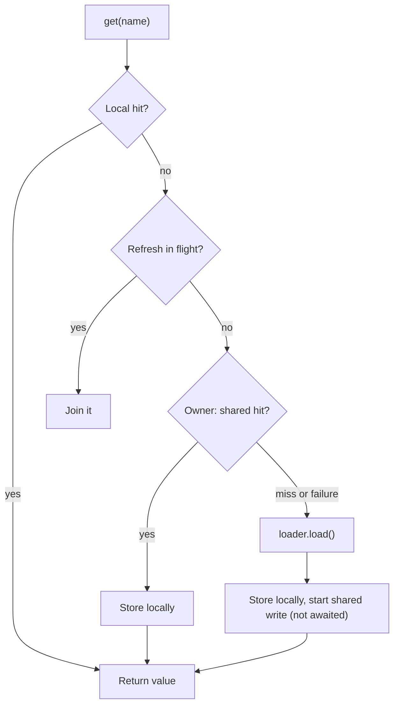

# reference-data-cache

[](https://github.com/jtkunley/reference-data-cache/actions/workflows/ci.yml)
[](https://www.npmjs.com/package/reference-data-cache)
[](LICENSE)

Named, read-through caching for **reference data** in Node.js: country lists, product
catalogs, feature tables, anything small, read often, and loaded as a whole.

- **Two tiers.** A local in-memory cache in every process, plus an optional shared tier
  (Redis, or anything implementing `CacheTier`).
- **Single-flight loading.** Concurrent misses for a domain share one shared read and one
  loader call per client.
- **Degrades gracefully.** Redis timeouts, outages, and corrupt entries are reported, never
  thrown at readers; the loader is the fallback.
- **No Redis dependency.** Bring any client that fits a three-method interface, or the
  callback API of `redis` v3.
- **Typed, dual ESM/CJS, zero runtime dependencies.**

## Install

```sh
npm install reference-data-cache
```

Requires Node.js 22 or later.

## Quick start

### Local-only reader

```ts
import { createCacheReader } from 'reference-data-cache';

const cache = createCacheReader({ inMemoryPolicy: { ttlMs: 60_000 } });

cache.register({
  name: 'countries',
  loader: { load: () => db.query('SELECT code, name FROM countries') },
});

const countries = await cache.get<Country[]>('countries');
```

### Owner with a shared Redis tier

```ts
import { createClient } from 'redis';
import { RedisCacheTier, createCacheOwner } from 'reference-data-cache';

const redis = createClient();
await redis.connect();

const sharedTier = new RedisCacheTier({
  get: (key) => redis.get(key),
  set: async (key, value, ttlMs) => {
    await redis.set(key, value, { PX: ttlMs });
  },
  delete: async (key) => {
    await redis.del(key);
  },
});

const cache = createCacheOwner({
  sharedTier,
  inMemoryPolicy: { ttlMs: 60_000 },
  onTierError: ({ domain, operation, kind, error }) => {
    logger.warn({ domain, operation, kind, err: error }, 'shared cache failure');
  },
});

cache.register({
  name: 'countries',
  loader: { load: loadCountries },
  sharedPolicy: { ttlMs: 3_600_000 },
});

const countries = await cache.get<Country[]>('countries');

// After the source data changes:
await cache.invalidate('countries');
```

### `redis` v3 (callback API)

```ts
import redis from 'redis';
import { createRedisCacheTierFromRedisV3 } from 'reference-data-cache';

const sharedTier = createRedisCacheTierFromRedisV3(redis.createClient(), {
  operationTimeoutMs: 250,
});
```

The adapter calls `get(key, cb)`, `set(key, payload, 'PX', ttlMs, cb)`, and `del(key, cb)`.
Creating, reconnecting, and closing the connection remain your responsibility.

## How a read works



A reader skips the shared step. Shared read failures are reported to `onTierError` and
treated as misses; a corrupt shared value is also deleted in the background.

## Concepts

**Domain.** One named cached value with a loader. Names are exact and case-sensitive.
Loaders take no arguments and must not resolve to `null` or `undefined`; falsy values like
`0`, `false`, `''`, `[]`, and `{}` are fine. Loader errors propagate to every waiting caller
and are not cached, so the next read tries again.

**Policies.** `{ ttlMs }`. The local TTL defaults to 5 minutes; set a client default with
`inMemoryPolicy` and override it per domain. Owners use the domain's `sharedPolicy` or the
shared tier's default at registration time, and reject a local TTL longer than the shared
TTL. Policies are copied and frozen on registration.

**Expiry.** Entries expire `ttlMs` after their latest write; reading does not extend them.
A value promoted from the shared tier gets a full local TTL, regardless of how long it had
left in the shared tier. There is no background refresh, stale-while-revalidate, capacity
limit, or eager eviction.

**References.** Local values are kept by reference, not cloned or frozen. Values that pass
through Redis go through JSON, so use JSON-compatible data if results must match across
tiers.

## API

### Clients

| Function                      | Returns       | Notes                                          |
| ----------------------------- | ------------- | ---------------------------------------------- |
| `createCacheReader(options?)` | `CacheReader` | Local cache only. `options.inMemoryPolicy`.    |
| `createCacheOwner(options)`   | `CacheOwner`  | Requires `sharedTier`; optional `onTierError`. |

- `register(domain)` is synchronous. It throws `CacheDomainAlreadyRegisteredError` for
  duplicates and `TypeError`/`RangeError` for invalid definitions, and leaves nothing
  registered when it fails.
- `get<T>(name)` resolves the value or rejects with `CacheDomainNotRegisteredError` or
  the loader's error. `T` is an unchecked assertion.
- `invalidate(name)` (owners only) clears the local value immediately, deletes the shared
  value, and resolves when the delete succeeds. It rejects with the delete failure, which
  is also reported to `onTierError`, but the local value is cleared either way.

### Tiers

| Class               | `NAME`        | Default TTL | TTL rule              |
| ------------------- | ------------- | ----------- | --------------------- |
| `InMemoryCacheTier` | `'in-memory'` | 5 minutes   | finite, `>= 0`        |
| `RedisCacheTier`    | `'redis'`     | 12 hours    | positive safe integer |

Both implement `CacheTier`: `defaultPolicy`, `setDefaultPolicy`, `register`, `unregister`,
`get` (resolving `{ hit: false }` or `{ hit: true, value }`), `set`, and `delete`.
`RedisCacheTier` stores JSON under `reference-data-cache:v1:<domainName>` and applies
`operationTimeoutMs` (default `DEFAULT_REDIS_OPERATION_TIMEOUT_MS`, 500 ms) to each call.
Its `unregister` leaves the stored key in place.

Tiers track registrations, so give each owner its own tier instance. Several
`RedisCacheTier` instances can wrap the same Redis connection.

### Tier error events

`onTierError` receives `{ domain, tier: 'shared', operation, kind, error }` once per failed
shared operation, where `operation` is `get`, `set`, or `delete` and `kind` is `timeout`,
`serialize`, `corrupt-value`, or `error`. The original failure is passed through unchanged.
Return values are ignored, and throws or rejections from the hook are contained.

### Errors

| Error                               | When                                         |
| ----------------------------------- | -------------------------------------------- |
| `CacheDomainAlreadyRegisteredError` | Registering a name twice on a client or tier |
| `CacheDomainNotRegisteredError`     | Using a name that was never registered       |
| `CacheTierTimeoutError`             | A Redis call exceeded `operationTimeoutMs`   |
| `CacheTierSerializationError`       | A value could not be converted to JSON       |
| `CacheTierCorruptValueError`        | A stored Redis value was not valid JSON      |

All expose `domainName`; the timeout error also exposes `operation` and `timeoutMs`.

## Guarantees and limits

The library deliberately does **not** provide:

- **Cross-process coordination.** Single-flight loading is per client instance. Other
  processes may load the same domain at the same time.
- **Invalidation broadcast.** `invalidate` clears the calling owner's local value and the
  shared entry. Other processes keep their local values until they expire.
- **A freshness barrier.** Reads that overlap an invalidation may see older values, and a
  shared write dispatched before invalidation may still land afterwards. If the shared
  delete fails, later reads may bring the old shared value back.
- **Write confirmation.** A successful `get` does not mean the value reached Redis; shared
  writes are best effort and not awaited, and there is no drain on shutdown.
- **Cancellation.** A Redis timeout stops waiting but does not cancel the request.
  Loaders and custom tiers have no timeout; if they hang, callers wait.
- **Schema validation.** Values are not checked at runtime.

The full behavioral contract is in [`docs/behavior-spec.md`](docs/behavior-spec.md).

## Development

```sh
npm install
npm run check   # typecheck, lint, format check, tests
npm run build   # dist/ (ESM + CJS + type declarations)
```

See [CONTRIBUTING.md](CONTRIBUTING.md).

## License

[MIT](LICENSE)
